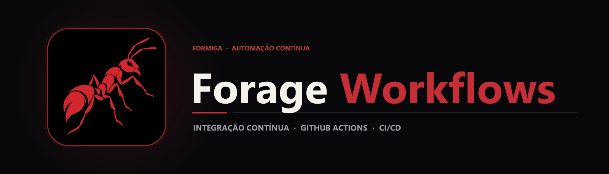

  

  Configuração de pipelines de automação e Integração Contínua (CI) orientada a eventos utilizando GitHub Actions.

  
  
  

## Sobre o projeto

A automação de tarefas repetitivas no ciclo de vida de software depende de pipelines declarativos que reajam de forma confiável a eventos do repositório. Este projeto foi construído durante uma simulação prática na plataforma **Forage**, focada na configuração e execução de fluxos automatizados com **GitHub Actions**.

O repositório define um workflow em .github/workflows/first-workflow.yml que provisiona um runner isolado em nuvem e executa etapas sequenciais a partir de gatilhos do GitHub, servindo como base estrutural para esteiras de testes, linting e deploy.

## Principais recursos

| Recurso | Como funciona |
|---|---|
| Gatilhos orientados a eventos | O workflow monitora eventos do repositório para iniciar a execução automaticamente sem intervenção manual. |
| Provisionamento de Runner | Alocação sob demanda de ambiente virtualizado limpo para execução dos jobs definidos. |
| Execução em etapas (Steps) | Encadeamento declarativo de ações oficiais (uses) e comandos de shell (
un). |
| Rastreabilidade de logs | Cada etapa registra saída detalhada na aba *Actions* do GitHub para auditoria e diagnóstico. |

## Tecnologias

  
  
  

- **GitHub Actions** como motor de orquestração de pipelines CI/CD;
- **YAML (.github/workflows/first-workflow.yml)** para definição declarativa de gatilhos, jobs e steps.

## Arquitetura

`mermaid
flowchart LR
    A[Evento no Repositório] --> B[Gatilho GitHub Actions]
    B --> C[Alocação do Runner Virtual]
    C --> D[Checkout do Código]
    D --> E[Execução dos Steps do Job]
    E --> F[Relatório de Status no GitHub]
`

## Estrutura do repositório

`	ext
forage-github-task/
├── .github/
│   └── workflows/
│       └── first-workflow.yml      Definição declarativa do pipeline GitHub Actions
├── assets/
│   ├── banner.png                  Banner principal do projeto
│   └── project-animal.png          Símbolo da formiga
└── README.md
`

## Como explorar

1. Inspecione o arquivo [.github/workflows/first-workflow.yml](.github/workflows/first-workflow.yml) para verificar os gatilhos (on:), o ambiente (
uns-on:) e os passos configurados.
2. Acesse a aba **Actions** deste repositório no GitHub para visualizar o histórico de execuções e o tempo de cada etapa.

---

Estudo · construção · evolução <a href="https://github.com/arthurlynow098">Perfil</a> · <a href="https://arthurentsev.vercel.app/">Portfólio</a> · <a href="https://www.linkedin.com/in/entsevarthur/">LinkedIn</a>

