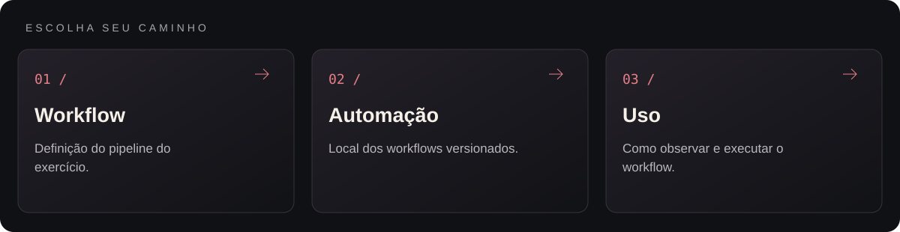
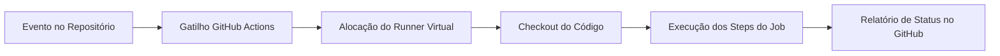
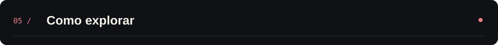

<p align="center">
  
</p>

<p align="center">Exercício de integração contínua e automação de workflows com GitHub Actions.</p>

<p align="center"></p>

<p align="center"><a href="#visão-geral">Visão geral</a> &nbsp;·&nbsp; <a href="#recursos">Recursos</a> &nbsp;·&nbsp; <a href="#como-explorar">Como explorar</a></p>

---

<a id="explore-o-projeto"></a>




<table width="100%">
<tr><th align="left">Área</th><th align="left">O que você encontra</th><th align="left">Acesso direto</th></tr>
<tr><td><strong>Workflow</strong></td><td>Definição do pipeline do exercício.</td><td><a href=".github/workflows/first-workflow.yml">Abrir workflow →</a></td></tr>
<tr><td><strong>Automação</strong></td><td>Local dos workflows versionados.</td><td><a href=".github/workflows">Abrir automação →</a></td></tr>
<tr><td><strong>Uso</strong></td><td>Como observar e executar o workflow.</td><td><a href="README.md">Abrir uso →</a></td></tr>
</table>

<a id="visão-geral"></a>


O repositório define um workflow em .github/workflows/first-workflow.yml que provisiona um runner isolado em nuvem e executa etapas sequenciais a partir de gatilhos do GitHub, servindo como base estrutural para esteiras de testes, linting e deploy.

<a id="recursos"></a>


| Recurso | Como funciona |
|---|---|
| Gatilhos orientados a eventos | O workflow monitora eventos do repositório para iniciar a execução automaticamente sem intervenção manual. |
| Provisionamento de Runner | Alocação sob demanda de ambiente virtualizado limpo para execução dos jobs definidos. |
| Execução em etapas (Steps) | Encadeamento declarativo de ações oficiais (uses) e comandos de shell (run). |
| Rastreabilidade de logs | Cada etapa registra saída detalhada na aba *Actions* do GitHub para auditoria e diagnóstico. |

<a id="tecnologias"></a>


- **GitHub Actions** como motor de orquestração de pipelines CI/CD;
- **YAML (.github/workflows/first-workflow.yml)** para definição declarativa de gatilhos, jobs e steps.

<details>
<summary>Arquitetura</summary>



</details>

<details>
<summary>Estrutura do repositório</summary>

```text
forage-github-task/
├── .github/
│   └── workflows/
│       └── first-workflow.yml      Definição declarativa do pipeline GitHub Actions
├── assets/
│   └── banner-v2.png               Banner do projeto
└── README.md
```

</details>

<a id="como-explorar"></a>



1. Inspecione o arquivo [.github/workflows/first-workflow.yml](.github/workflows/first-workflow.yml) para verificar os gatilhos (on:), o ambiente (runs-on:) e os passos configurados.
2. Acesse a aba **Actions** deste repositório no GitHub para visualizar o histórico de execuções e o tempo de cada etapa.

---

<p align="center">
  <a href="https://github.com/arthurlynow098">GitHub</a> &nbsp;·&nbsp;
  <a href="https://arthurentsev.vercel.app/">Portfólio</a> &nbsp;·&nbsp;
  <a href="https://www.linkedin.com/in/entsevarthur/">LinkedIn</a>
</p>
